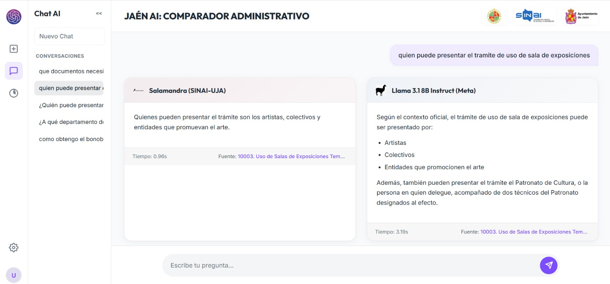

<div align="center">
  
  <h1>Asistente Virtual de Trámites Administrativos</h1>
  <p><strong>Sede Electrónica del Ayuntamiento de Jaén — Pipeline RAG Multi-Modelo</strong></p>

  [](https://www.python.org/)
  [](https://fastapi.tiangolo.com/)
  [](https://github.com/facebookresearch/faiss)
  [](https://ragas.io/)
  [](https://sinai.ujaen.es/)
</div>

---

Este repositorio alberga el código fuente, los datos y el marco de auditoría científica del Trabajo de Fin de Grado (TFG): **"Asistente Virtual de Trámites Administrativos"**, desarrollado por **Mario Martínez Gallego** bajo la tutoría de **Eugenio Martínez Cámara** y **María Teresa Martín Valdivia** en la Escuela Politécnica Superior de la Universidad de Jaén (UJA), en colaboración con el grupo de investigación **SINAI**.

> 📄 **Documentación Académica (Memoria del TFG)**:
> - 🌐 **[▶️ Leer Memoria completa online en Google Drive (PDF)](https://drive.google.com/file/d/1WV80HBT2AVECRZzQN9qtnS2aa9DDrz7I/view?usp=sharing)** *(Recomendado para lectura inmediata y cómoda en el navegador)*
> - 📥 **[Descargar PDF directamente (`Memoria_TFG.pdf` - 12.1 MB)](https://github.com/mariomgallego7inv-web/asistente-virtual-jaen-rag/raw/main/Memoria_TFG.pdf)**
> - 📁 **Ubicación en el repositorio**: [`Memoria_TFG.pdf`](Memoria_TFG.pdf) / [`docs/Memoria_TFG.pdf`](docs/Memoria_TFG.pdf)

<br/>

<div align="center">
  
  <p><em>Figura: Interfaz del Asistente Virtual de Trámites Administrativos con comparativa en doble columna y streaming paralelo.</em></p>
</div>

---

## 🌟 Características Principales

- **Ingesta Normativa y Scraping Automatizado**: Extracción limpia de trámites oficiales de la sede municipal, procesando campos clave, metadatos y enlaces de tramitación.
- **Indexación Vectorial Densa**: Espacio latente generado mediante el modelo especializado `dariolopez/bge-m3-es-legal-tmp-6`, indexando 6.990 fragmentos documentales en una base vectorial FAISS.
- **Backend Asíncrono de Alto Rendimiento**: Servidor FastAPI con bucle de eventos AsyncIO y transmisión en tiempo real mediante **Server-Sent Events (SSE)**.
- **Comparador Simultáneo en Doble Columna**: Inferencia paralela con los clústeres de supercomputación remota (ADA de la UJA y clúster Helmholtz de Alemania), contrastando las respuestas de:
  - `ALIA-es-legal-administrative-7B-Instruct` (Salamandra / ALIA-legal)
  - `Llama-3.1-8B-Instruct` (Meta)
  - `Apertus-8B-Instruct` (Alemania)
- **Persistencia de Conversaciones (RF-1)**: Gestión de historial de consultas con almacenamiento en `conversations.json`.
- **Carga No Bloqueante**: Hilo secundario para inicialización del índice vectorial FAISS y pantalla animada de espera (`loading.html`).

> [!NOTE]  
> **Disponibilidad de los Modelos, VPN y Endpoints Remotos**:  
> Durante el periodo de realización y defensa de este Trabajo de Fin de Grado, se dispuso de acceso e infraestructura en el clúster de supercomputación **ADA de la Universidad de Jaén (nodo del grupo de investigación SINAI)** y en la plataforma europea **Helmholtz Cloud (Blablador)**.  
> Para comunicarse con los modelos alojados en el servidor ADA de la UJA (`ada01.ujaen.es`), además de contar con las claves de acceso autorizadas, **es requisito indispensable estar conectado a la Red Privada Virtual (VPN) de la Universidad de Jaén**.  
> Dado que las credenciales de investigación y permisos de acceso estaban acotados temporalmente a la vigencia del TFG, actualmente las llamadas en vivo a dichos servidores devolverán error de conexión o autenticación. No obstante, **todas las inferencias, registros completos y evaluaciones científicas se encuentran preservadas y consolidadas en las carpetas `data/` y `results/`** para su completa inspección y reproducción sin necesidad de dependencias externas.

---

## 🎬 Vídeo de Demostración del Asistente

Para observar el funcionamiento interactivo en tiempo real del asistente, la comparativa de respuestas en doble columna por streaming y la gestión del historial de consultas:

- 🌐 **[▶️ Ver vídeo online en Google Drive](https://drive.google.com/file/d/1kieUCWLv94RjmzHCDyE0bCbayojcx3ql/view)** *(Recomendado para visualización inmediata en el navegador)*
- 📥 **[Descargar vídeo directamente (`demo.mp4` - 4.3 MB)](https://github.com/mariomgallego7inv-web/asistente-virtual-jaen-rag/raw/main/demo.mp4)**
- 📁 **Ubicación en el repositorio local**: [`demo.mp4`](demo.mp4) / [`docs/demo.mp4`](docs/demo.mp4)

---

## 🔬 Marco de Evaluación y Auditoría Científica (Capítulo 7)

El sistema ha sido evaluado bajo el paradigma **LLM-as-a-Judge** utilizando el framework **Ragas** sobre un conjunto de prueba de **843 preguntas sintéticas**:

### 1. Evaluación del Recuperador (Retriever)
- **Evaluación Determinista**: Comparativa sistemática de búsqueda léxica (BM25), vectorial densa (FAISS) e híbrida (RRF) en Top-3 y Top-5.
- **Métricas Probabilísticas (Juez Gemma-3-12B-it)**:
  - **Context Precision**: **86,56%**
  - **Context Recall**: **83,26%**
- **Auditoría de Fallos**: Diagnóstico y tipificación de las 65 consultas con precisión nula (195 fragmentos clasificados).

### 2. Evaluación del Generador (Generator)
- **Evaluación Semántica (Juez Qwen-3.6-35B)**:
  - **Llama-3.1-8B-Instruct**: Relevancia: `0.6122` | Fidelidad: `0.6809` (Modelo más disciplinado ante el contexto).
  - **Salamandra-7B-It (ALIA-legal)**: Relevancia: `0.6992` | Fidelidad: `0.5163` (Mayor afinidad léxica y vocabulario legal).
  - **Apertus-8B-Instruct**: Relevancia: `0.4153` | Fidelidad: `0.4588`.
- **Pruebas de Alucinación en Contexto Nulo**: Inyección forzada de ruido puro sobre las consultas fallidas para evaluar la adherencia al prompt de seguridad.

---

## 📁 Estructura del Repositorio

```text
asistente-virtual-jaen-rag/
├── .gitignore                     # Filtros para Git (.venv, caches, temporales)
├── README.md                      # Documentación del proyecto
├── requirements.txt               # Dependencias de Python exactas
├── iniciar_comparador.bat         # Script de despliegue rápido en Windows
├── conversations.json             # Almacenamiento local del historial de chats
├── demo.mp4                       # Vídeo de demostración del asistente en acción
├── Memoria_TFG.pdf                # Documento completo de la Memoria del Trabajo de Fin de Grado
│
├── docs/                          # Documentación académica y audiovisual
│   ├── Memoria_TFG.pdf            # Memoria del TFG en formato PDF
│   └── demo.mp4                   # Vídeo de demostración en alta definición
│
├── app.py                         # Servidor backend FastAPI (endpoints SSE, streaming)
├── obtenerCampos.py               # Descubrimiento de estructura y etiquetas web
├── Scraper.py                     # Descarga y depuración masiva de trámites
├── indices.py                     # Segmentación (chunking) y generación de FAISS
│
├── faiss_index_final/             # Índice vectorial persistente entrenado (6.990 chunks)
│   ├── index.faiss
│   ├── index.pkl
│   └── bm25_chunks_final.pkl
│
├── templates/                     # Vistas web Jinja/HTML
│   ├── index.html                 # Interfaz comparadora en doble columna
│   └── loading.html               # Pantalla de carga animada durante startup
│
├── static/                        # Recursos de interfaz de usuario
│   ├── style.css                  # Estilos visuales adaptados a la sede electrónica
│   └── script.js                  # Lógica del cliente web y eventos SSE
│
├── imagenes/                      # Logotipos oficiales y captura de la interfaz (capturaInterfaz.jpeg)
│
├── data/                          # Conjuntos de datos del TFG
│   ├── dataset_evaluacion.json    # Dataset de 843 preguntas/respuestas de referencia
│   ├── dataset_generado_multimodelo.json # Inferencia de los 3 modelos para evaluación
│   ├── tramites_index.csv         # Índice general de trámites con metadatos
│   └── tramites_txt/              # 109 trámites en texto depurado
│
├── evaluacion/                    # Scripts del Capítulo 7 (Auditoría Científica)
│   ├── dataset.py                 # Generador del dataset sintético (PersonaHub + Groq)
│   ├── extraer_Pasajes.py         # Módulo extractor de pasajes estructurados HTML
│   ├── rec_determinista.py        # Evaluación BM25 vs FAISS vs Híbrido RRF (Tabla 7.1)
│   ├── rec_Ragas.py               # Evaluación del recuperador con Gemma-3-12B-it (Tabla 7.2)
│   ├── auditoria_gemma.py         # Diagnóstico de errores de Context Precision = 0.0 (Tabla 7.3)
│   ├── generacion_respuestas.py   # Inferencia masiva con los modelos evaluados
│   ├── gen_Ragas.py               # Evaluación del generador con Qwen-3.6-35B (Tabla 7.4)
│   ├── rescatar_errores.py        # Postprocesamiento y reintentos ante fallos de formato
│   ├── calcular_medias.py         # Cálculo y resumen de métricas consolidadas
│   └── generar_respuesta_Prec0.py # Evaluación de alucinaciones sin contexto (Tabla 7.5)
│
└── results/                       # Resultados empíricos de la investigación
    ├── evaluacion_determinista_recuperador.csv  # Datos experimentales Tabla 7.1
    ├── metricas_recuperador.json               # Resultados de Gemma Tabla 7.2
    ├── metricas_recuperador_top5.json          # Comparativa con ventana K=5
    ├── informe_documentos_fallidos_K3.json     # Catálogo de fallos Tabla 7.3
    ├── metricas_generadores.json               # Evaluaciones consolidadas Tabla 7.4
    └── respuestas_sin_contexto_prec0.json      # Inferencia en contexto nulo Tabla 7.5
```

---

## 🚀 Guía de Instalación y Uso

### Requisitos Previos
- Python 3.12 (recomendado)
- Acceso a internet (para resolver dependencias iniciales y modelos de embeddings locales)
- **Nota técnica sobre los LLMs**: Los modelos remotos (`Salamandra-7B` y `Llama-3.1` en el clúster ADA de la UJA, y `Apertus-8B` en Helmholtz) requieren conexión a sus respectivos servidores de inferencia y, en el caso del servidor de la Universidad de Jaén (`ada01.ujaen.es`), **estar conectado a la VPN de la Universidad de Jaén**. Al haber finalizado la fase de investigación del TFG, dichos endpoints se encuentran actualmente cerrados.

### Opción A: Despliegue Rápido en Windows
Haz doble clic sobre el archivo ejecutable por lotes:
```cmd
iniciar_comparador.bat
```
El script creará automáticamente el entorno virtual `.venv` en caso de no existir, instalará las dependencias necesarias de `requirements.txt`, abrirá el navegador en `http://127.0.0.1:8000` y arrancará el servidor FastAPI.

### Opción B: Arranque Manual por Consola
1. Clonar el repositorio y acceder a la carpeta:
   ```bash
   cd asistente-virtual-jaen-rag
   ```
2. Crear y activar un entorno virtual:
   ```bash
   python -m venv .venv
   # En Windows:
   .venv\Scripts\activate
   # En Linux/macOS:
   source .venv/bin/activate
   ```
3. Instalar las dependencias del proyecto:
   ```bash
   pip install -r requirements.txt
   ```
4. Iniciar el servidor web:
   ```bash
   uvicorn app:app --host 127.0.0.1 --port 8000
   ```
5. Acceder en el navegador a: `http://127.0.0.1:8000`.

---

## 📊 Reproducción de Resultados de Evaluación

Todos los scripts de evaluación están configurados para operar mediante rutas relativas autónomas. Para consultar el ranking final de generación expuesto en la **Tabla 7.4** de la memoria:

```bash
python evaluacion/calcular_medias.py
```

Salida esperada:
```text
============================================================
🏆 RANKING FINAL DE MODELOS (MEDIAS GLOBALES)
============================================================
MODELO                    | RELEVANCIA MEDIA | FIDELIDAD MEDIA
------------------------------------------------------------
Llama-3.1 (UJA)           | 0.6122           | 0.6809
Salamandra (UJA)          | 0.6992           | 0.5163
Apertus (Alemania)        | 0.4153           | 0.4588
============================================================
Total de preguntas analizadas: 843
```

---

## 🏛️ Créditos y Agradecimientos

- **Autor**: Mario Martínez Gallego
- **Tutores del TFG**: Dr. Eugenio Martínez Cámara y Dra. María Teresa Martín Valdivia
- **Titulación**: Grado en Ingeniería Informática — Escuela Politécnica Superior de Jaén
- **Grupo de Investigación**: [SINAI](https://sinai.ujaen.es/) (Sistemas Inteligentes de Acceso a la Información), grupo en el que se realizaron las prácticas de empresa y se dio inicio a este Trabajo de Fin de Grado.
- **Agradecimientos**: Al consorcio BSC/SINAI por el soporte de cómputo en el clúster ADA y a la red Helmholtz Cloud (Blablador) por el soporte de inferencia con Qwen y Apertus.

<br/>

<div align="center">
  
  &nbsp;&nbsp;&nbsp;&nbsp;&nbsp;&nbsp;&nbsp;&nbsp;&nbsp;&nbsp;
  
</div>
